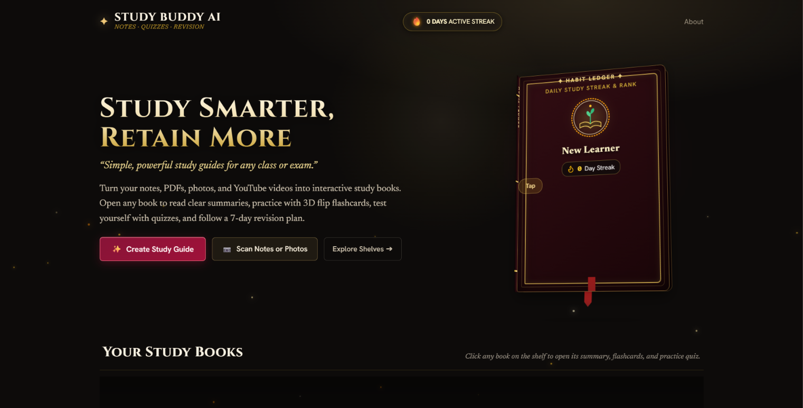
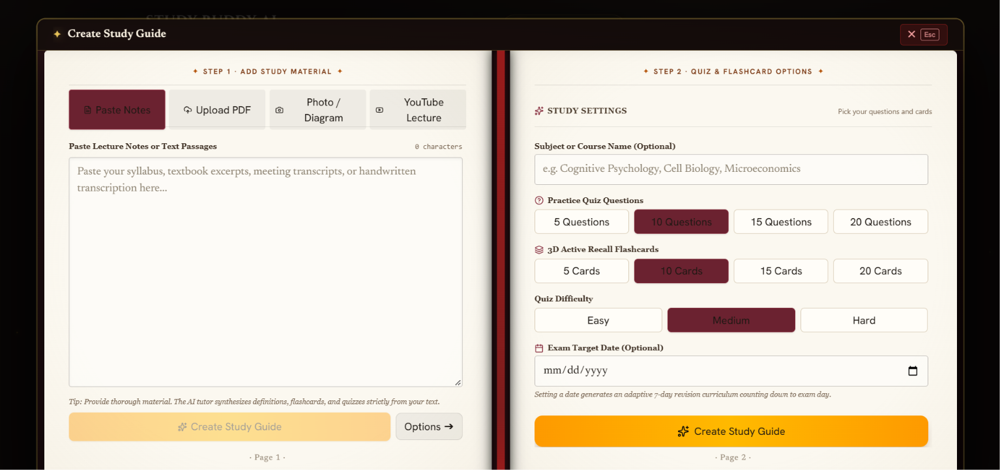
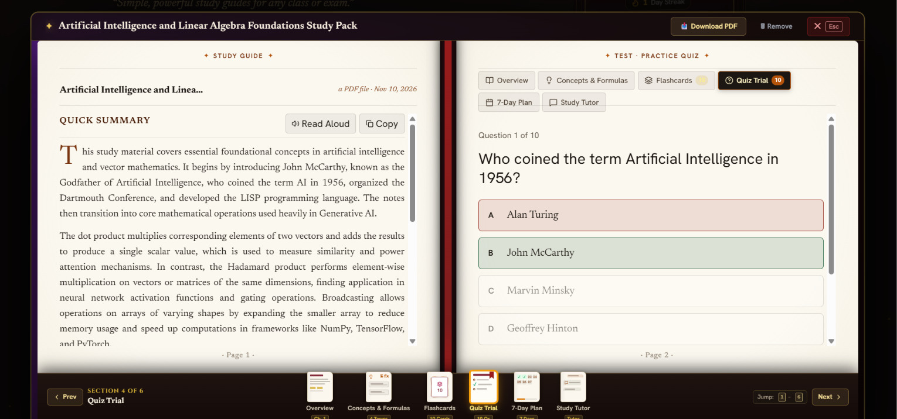
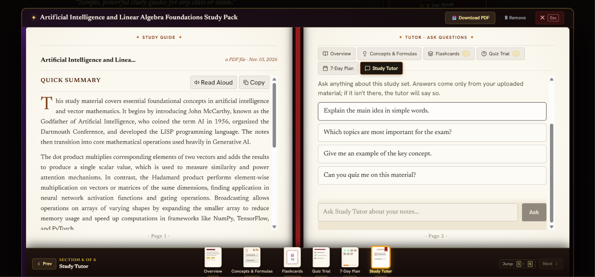

# Study Buddy AI

Smart notes summarizer, quiz generator and revision planner.

Upload a PDF, paste your notes, or add a YouTube lecture link, and Study Buddy AI turns it into a complete study pack in about a minute: summary, key concepts, definitions, formulas, flashcards, multiple-choice questions with explanations, and a 7-day revision plan. You can then chat with your notes and download the whole pack as a PDF.

## Live demo

| | |
| --- | --- |
| **Live app** | _https://study-buddy-ai-mjwz.onrender.com/_ |
| **GitHub repository** | _https://github.com/diyasanjeevmenon-alt/StudyBuddyAI_ |

> The app is hosted on a free tier, so the first request after a period of inactivity can take up to a minute while the server wakes up.

## Screenshots

_Add screenshots to a `docs/screenshots/` folder and reference them here, for example:_









## Features

| Requirement | Implementation |
| --- | --- |
| **PDF upload** | Text is extracted on the server with `unpdf`. Scanned PDFs (no selectable text) are read directly by the multimodal AI model. |
| **Paste text** | Notes are sent straight to the generator. |
| **YouTube link** | The transcript is fetched with `youtube-transcript`. If captions are unavailable, the user can paste the transcript instead. |
| **Preferences** | Subject (optional), number of MCQs (5/10/15/20), number of flashcards (5/10/15/20), difficulty (easy/medium/hard), exam date (optional). |
| **AI-generated pack** | Summary (150-300 words), 5-10 key concepts, definitions, formulas (when present), flashcards, MCQs with 4 options + correct answer + explanation, 7-day revision plan (when an exam date is given). |
| **Structured output** | The model is called with a JSON schema; the response is then validated and normalised on the server (counts, 4 options per MCQ, valid answer index). A failed validation is retried once. |
| **Chat with notes** | The tutor answers only from the uploaded material and replies *"The requested information was not found in the provided material."* when the answer is not there. Four tutor modes: Study Tutor, Problem Solver, Quick Review, Practice Quizzer. |
| **PDF export** | Title, summary, key concepts, definitions, formulas, flashcards, MCQs with answers and the revision plan (generated with `jsPDF`). |
| **Save study sets** | Each browser gets its own shelf (anonymous client id, no login needed). Sets are stored on the server and can be reopened or deleted. |
| **Extras** | Photo/diagram scanner, verified daily study streak, revision-plan checklist, read-aloud summary. |

## Tech stack

| Layer | Technology |
| --- | --- |
| Frontend | React 19, Vite, Tailwind CSS 4, Three.js (3D book), Motion |
| Backend | Node.js, Express, TypeScript (run with `tsx`) |
| AI | Google Gemini API (`@google/genai`) |
| PDF parsing | `unpdf` |
| YouTube transcripts | `youtube-transcript` |
| Storage | JSON file on the server + `localStorage` for streak and plan progress |
| PDF export | `jsPDF` |
| Hosting | Render (single web service serving both API and frontend) |

## How it works

```
Browser (React)  --->  Express server  --->  Gemini API
   |                    |  /api/generate  (PDF / text / YouTube / image -> study pack)
   |                    |  /api/chat      (answers grounded in the saved notes)
   |                    |  /api/sets      (list / open / delete saved sets)
   |                    |  /api/sets/:id/pdf (download study pack)
   |                    '-- studybuddy-data.json (saved sets)
   '-- localStorage (client id, streak, plan progress)
```

In production the same Express server also serves the built frontend from `dist/`, so there is one service to deploy and no CORS to configure.

## Run locally

Requirements: Node.js 20 or newer and a Gemini API key from <https://aistudio.google.com/apikey>.

```bash
git clone <your-repository-url>
cd <repository-folder>
npm install
cp .env.example .env        # Windows: copy .env.example .env
# open .env and paste your key after GEMINI_API_KEY=
npm run dev
```

Open <http://localhost:3000>.

### Production build locally

```bash
npm run build
npm start
```

### Environment variables

| Variable | Required | Description |
| --- | --- | --- |
| `GEMINI_API_KEY` | yes | Gemini API key. Stored only on the server; never sent to the browser. |
| `PORT` | no | Server port (default `3000`; hosts such as Render set this automatically). |
| `GEMINI_MODEL` | no | Primary model (default `gemini-3.8-flash`). |
| `GEMINI_FALLBACK_MODEL` | no | Used automatically if the primary model fails (default `gemini-3.5-flash-lite`). |
| `DATA_FILE` | no | Path of the JSON file that stores saved sets (default `./studybuddy-data.json`). |

`.env` is listed in `.gitignore` and must never be committed.

## Deployment (Render)

1. Push this repository to GitHub.
2. On <https://render.com> choose **New > Web Service** and connect the repository (or use **New > Blueprint** to use the included `render.yaml`).
3. Settings:
   - **Runtime:** Node
   - **Build command:** `npm install --include=dev && npm run build`
   - **Start command:** `npm start`
4. Under **Environment**, add `GEMINI_API_KEY` with your key.
5. Deploy, then copy the public URL into the **Live demo** table above.

## API reference

| Method | Endpoint | Purpose |
| --- | --- | --- |
| GET | `/api/health` | Health check (also reports whether an AI key is configured) |
| GET | `/api/sets` | List saved sets for this browser |
| GET | `/api/sets/:id` | Open one saved set |
| DELETE | `/api/sets/:id` | Delete a saved set |
| POST | `/api/generate` | Create a study pack (`multipart/form-data` or JSON) |
| POST | `/api/chat` | Ask a question about a saved set |
| POST | `/api/analyze-image` | Analyse a photo of notes or a diagram |
| GET | `/api/sets/:id/pdf` | Download the study pack as a PDF |

All AI endpoints are rate limited per IP to protect the API key.

## Limitations and fallbacks

- **AI outage fallback.** If the AI service is unreachable, generation falls back to a simple rule-based builder (only when the app has text to work from). The result is clearly marked in the interface as lower quality. If there is no text to work from (for example a scanned PDF or photo), an error is shown instead.
- **YouTube transcripts.** Some videos have captions disabled, and YouTube sometimes blocks requests from cloud servers. In that case the app asks the user to paste the transcript.
- **Storage on free hosting.** Saved sets live in a JSON file. On Render's free tier the disk is reset on every deploy or restart, so saved sets can disappear. Attach a persistent disk and set `DATA_FILE` to a path on it, or swap in a database, for durable storage.
- **No login.** Sets are tied to an anonymous id stored in the browser. Clearing browser data loses access to its shelf.
- **Very long documents.** Only the first ~100,000 characters are used; a notice is shown when this happens.
- **PDF export fonts.** The exported PDF uses built-in fonts, so unusual symbols and non-Latin scripts are simplified or replaced.

## Project structure

```
server.ts            Express API, AI calls, PDF extraction, PDF export, static hosting
src/
  App.tsx            Page layout, shelf and modals
  api.ts             Typed client for the API
  components/        CreateForm, StudyView, Flashcards, Quiz, Plan, Chat, Shelf, ...
  streakManager.ts   Daily study streak (localStorage)
render.yaml          Render blueprint
.env.example         Template for environment variables
```

## License

MIT
